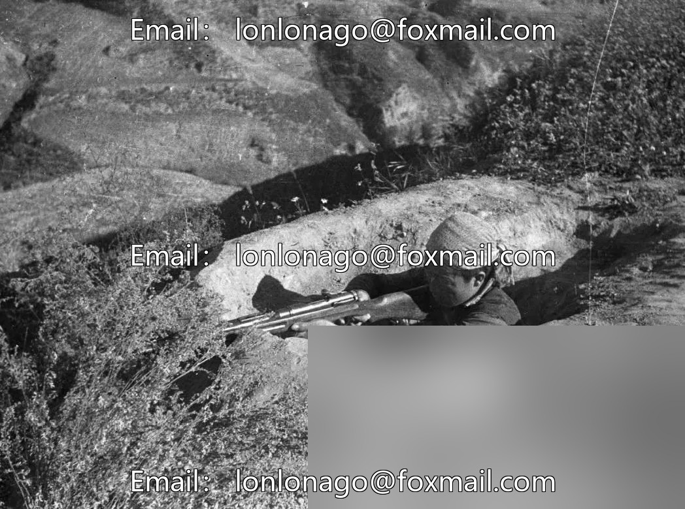
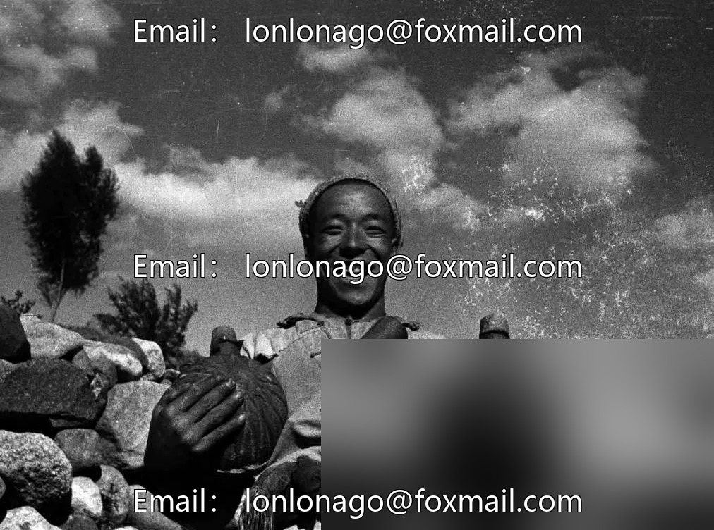
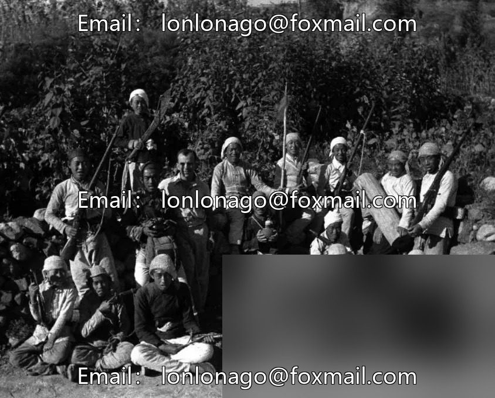
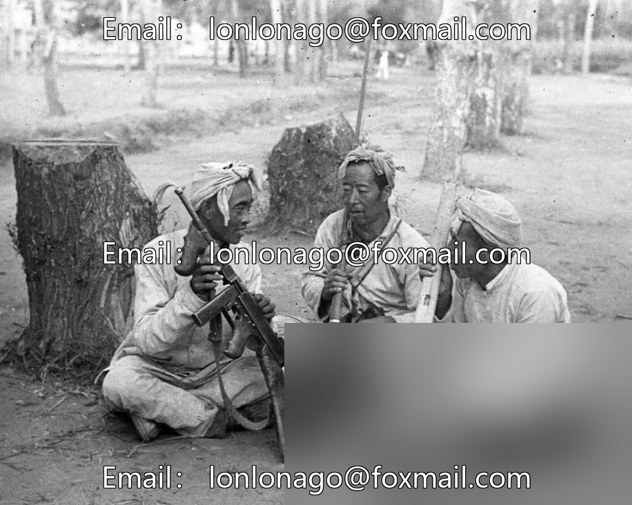
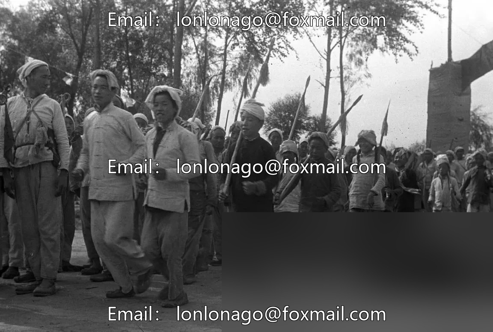
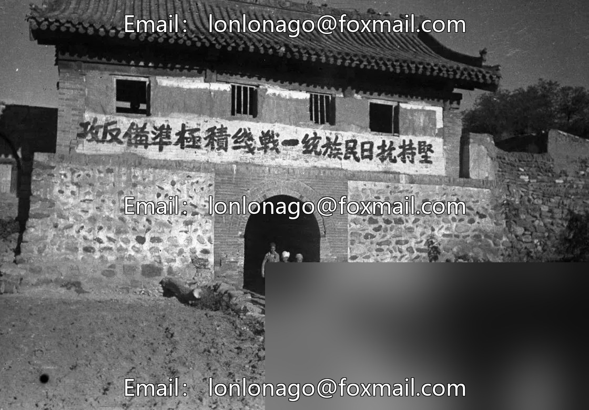
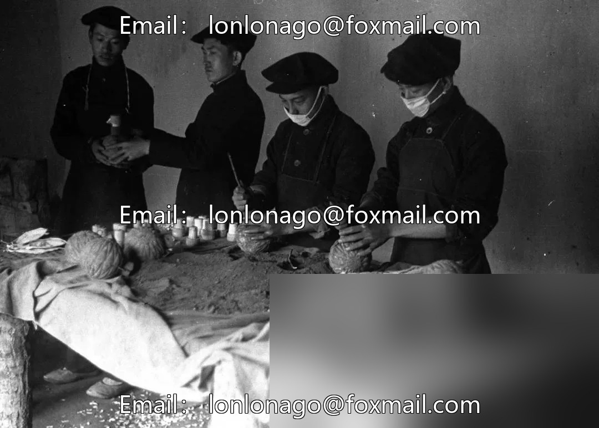
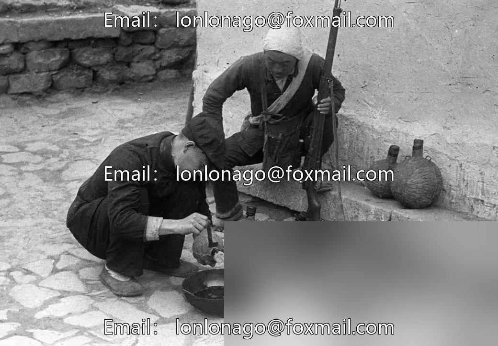

# Recorded old photos of humanistic photography in wartime of World War II during the 1932-1944 period.

## Body

Collected collection of old photographs of humanities in rural and urban areas during World War II during the war period 1932-1944, about 3000 high-definition images of anti-Japanese images, 6.8G.

Shocking and worth preserving, worth passing on to more people.
shared on a network platform, can be purchased directly.
I am online continuously, and shipment will be dispatched immediately.

A collection of war-time Second World War rural and city humanistic photography old photos from 1932-1944 is recorded, including anti-Japanese images and high-definition images totaling 6.8G.

<!-- AI_ENRICHED -->

## Images

## Payment

Here is a pay link on Stripe ( https://buy.stripe.com/3cs8yP7sY87d0vu9AB ). Please contact me lonlonago@foxmail.com after funding $89, and I will send you a complete data files , thank you!

